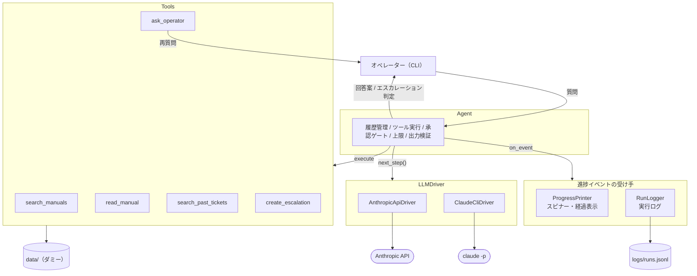
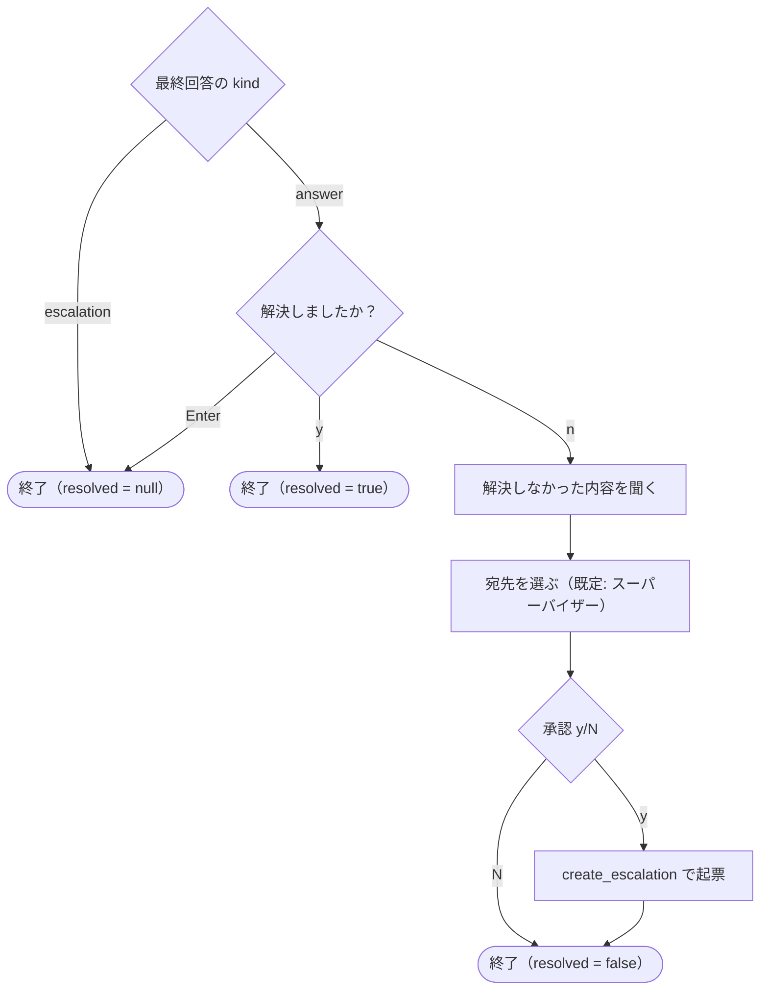
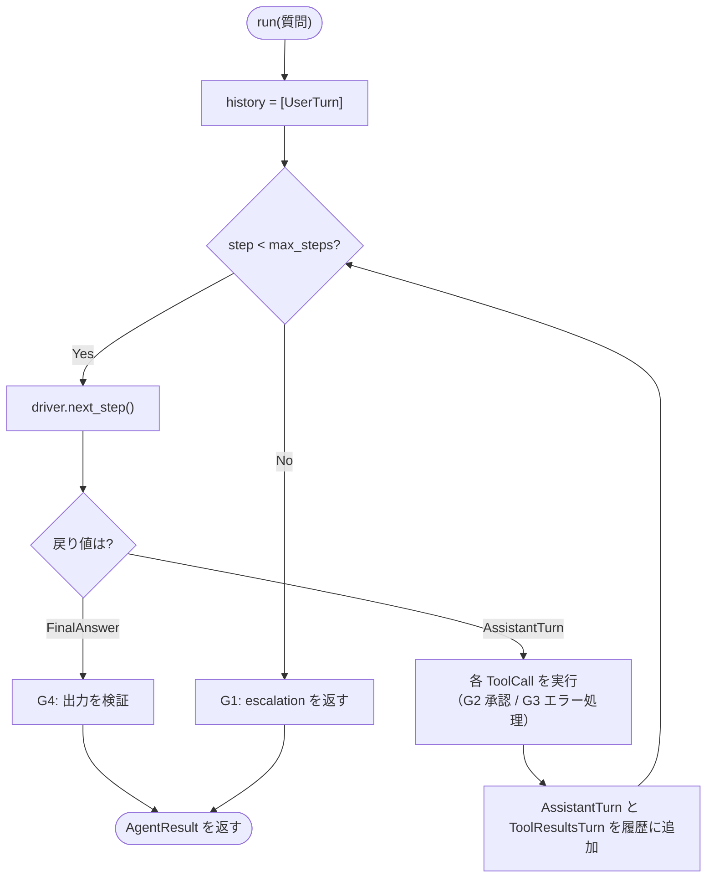
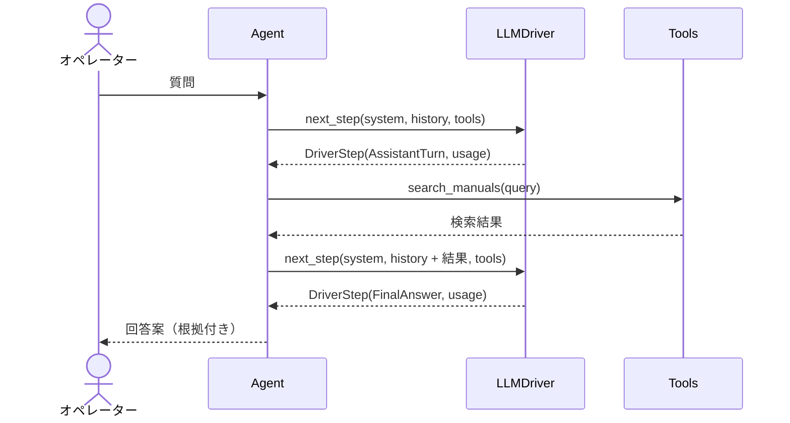
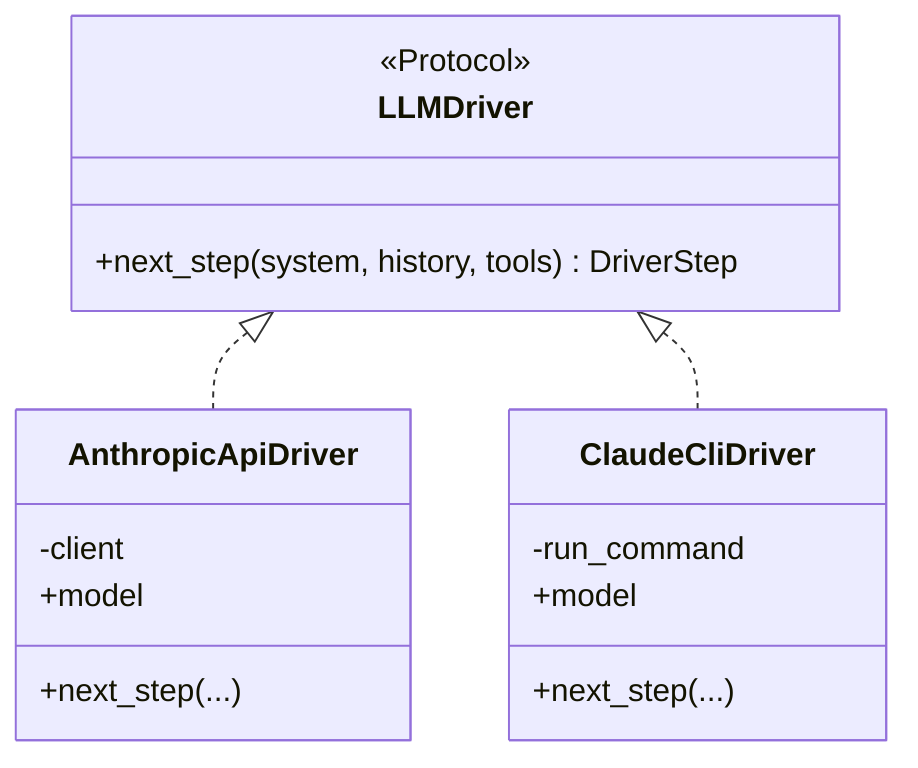
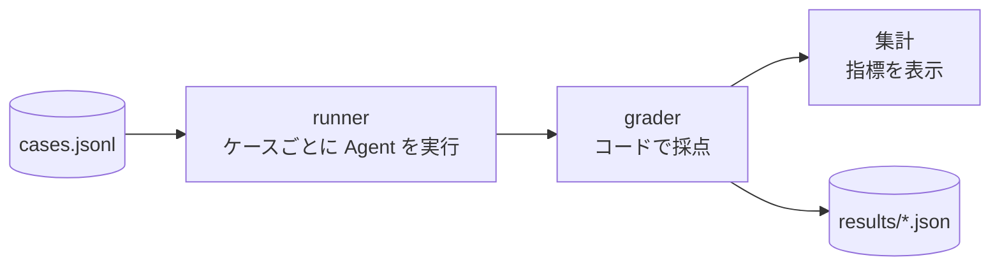

# sample-operator-help-agent

オペレーターからの社内問い合わせに一次回答する、学習用のサンプルAIエージェントです。
架空のサブスク動画アプリ「StreamBox」のマニュアルと過去の問い合わせ履歴（すべてダミー）をツールで調べ、**根拠付きの回答案**か**エスカレーション判定**を返します。

> [!NOTE]
> AIエージェントの基本構成を学ぶためのサンプルです。`data/` のマニュアル・問い合わせ履歴、`create_escalation` の起票先はすべてダミーで、実在のサービス・組織・システムとは関係ありません。

## 制限事項

- 検索はキーワードの部分一致のみ（全文検索・ベクトル検索は使っていない）
- 評価セットは自作の25ケースで、採点はコードによる判定のみ（回答内容の正しさは LLM や人では判定していない）
- 1回の実行で1つの質問に答える。会話の継続（続きの質問）には対応していない
- CLI ドライバーは実行した人の Claude Code のログイン情報で動く。複数人で使うサービスには API ドライバーを使う必要がある
- 承認・再質問・解決ヒアリングは、その場で端末から入力する前提（チャットツールなど非同期の環境では、会話の状態を保存して再開する仕組みが必要）

## 主な仕組み

| 仕組み | 対応する実装 |
|---|---|
| エージェントループ | `Agent.run()`：LLMに次の一手を聞き、ツールを実行して結果を返す、を最終回答まで繰り返す |
| ツール定義・Tool Use | `tools.py`：JSON Schemaで定義したツールと、その実装 |
| ガードレール・確認 | ループ回数の上限、副作用のあるツールの承認ゲート、出力の検証、ファイルアクセスの制限 |
| 人とのやりとり | `ask_operator`：情報不足時の再質問 / `followup.py`：回答後の解決ヒアリングと未解決時のエスカレーション |
| LLMの呼び出し方式の抽象化 | `drivers/`：Anthropic API と `claude -p` を同じインターフェースで切り替える |
| 可観測性 | 進捗イベント、実行中の表示（`progress.py`）、トークン量・費用の実行ログ（`run_log.py`） |
| 評価 | `evals/`：評価セットをエージェントに解かせ、コードで採点して指標を出す |

## 全体構成



## ディレクトリ構成

```
sample-operator-help-agent/
├── README.md
├── pyproject.toml
├── data/
│   ├── manuals/              # 業務マニュアル（Markdown）
│   ├── past_tickets.json     # 過去の問い合わせと回答
│   └── escalations.jsonl     # create_escalation の起票先（実行時に生成）
├── operator_help_agent/
│   ├── __main__.py           # CLIエントリポイント
│   ├── models.py             # 中立な型（履歴・ツール呼び出し・最終回答・トークン量）
│   ├── prompts.py            # システムプロンプト（回答案テンプレートを埋め込む）
│   ├── tools.py              # ツール定義と実装
│   ├── agent.py              # エージェントループ、ガードレール、進捗イベント
│   ├── progress.py           # 実行中の表示（スピナー・ツール呼び出しの経過）
│   ├── run_log.py            # 実行ログ（トークン量・費用・所要時間・解決したか）
│   ├── followup.py           # 回答後の解決ヒアリングと、未解決時のエスカレーション
│   └── drivers/
│       ├── base.py           # LLMDriver インターフェース
│       ├── api.py            # Anthropic API ドライバー
│       └── cli.py            # claude -p ドライバー
├── templates/
│   └── answer.md             # 回答案のフォーマット（Markdown テンプレート）
├── evals/
│   ├── __main__.py           # 評価の実行エントリポイント
│   ├── cases.jsonl           # 評価セット
│   ├── grader.py             # 採点（コードで判定）
│   ├── runner.py             # 全ケースの実行と集計
│   └── results/              # 評価結果（実行時に生成）
├── logs/
│   └── runs.jsonl            # 実行ログ（実行時に生成）
└── tests/
```

## セットアップ

| 必要なもの | 用途 |
|---|---|
| [uv](https://docs.astral.sh/uv/) | Python と依存関係の管理 |
| Python 3.12 | `uv python install 3.12` で入れる（`.python-version` で固定） |
| Claude Code（`claude` コマンド）にログイン済み | CLI ドライバー（`--driver cli`）で使う |
| 環境変数 `ANTHROPIC_API_KEY` | API ドライバー（`--driver api`）で使う |

```bash
uv sync
```

## 使い方

```bash
# claude -p ドライバーで実行
uv run python -m operator_help_agent --driver cli "月の途中で解約したら日割り返金ある？"

# 質問を省略すると「> 」と表示して入力を求める
uv run python -m operator_help_agent --driver cli

# API ドライバーで実行
uv run python -m operator_help_agent --driver api "月の途中で解約したら日割り返金ある？"
```

| オプション | 既定値 | 内容 |
|---|---|---|
| `--driver` | `api` | `api` / `cli` |
| `--model` | api: `claude-sonnet-5-5` / cli: `sonnet` | 使うモデル（例: `--model opus`） |
| `--max-steps` | `8` | ループ回数の上限（G1） |
| `--log-file` | `logs/runs.jsonl` | 実行ログの追記先 |

実行中は、LLM の応答を待つ間スピナーと経過秒数を表示し、ツールを呼ぶたびにその内容を1行ずつ表示する。
スピナーは標準エラー出力が端末のときだけ表示する。

```
⠹ Thinking... (3.2s)
  → search_manuals {"query": "解約 返金"}
  → search_past_tickets {"query": "解約 返金"}
⠼ Thinking... (8.1s)
```

`create_escalation` を呼ぶ前には、起票内容を表示して y/N の入力を求める。
LLM が再質問（`ask_operator`）したときは、確認事項を表示して答えの入力を求める。

```
  → search_manuals {"query": "返金"}

[確認] 契約はWebとApp Storeのどちらからですか？
> App Store
```

最後に、回答案またはエスカレーション判定、根拠、所要時間を表示する。LLM が回答文の先頭に `【回答案】` などの見出しを付けていた場合は、見出しが重ならないよう取り除いて表示する。
回答案の場合は、続けて解決したかをヒアリングする（下記）。最後に実行ログを `logs/runs.jsonl` に追記する。

質問・y/N・再質問への答えはキーボードから入力するため、通常のターミナルで実行する。
入力待ちの `>` は、標準出力が端末のときだけ点滅させる（ANSI の点滅。対応していない、または点滅が無効なターミナルでは普通に表示される）。

## 回答案のフォーマット（`templates/answer.md`）

最終回答が `answer` のとき、`message` はこのテンプレートに沿った Markdown で書かせる。エスカレーション判定の文章は自由形式。

```markdown
## 回答
（1〜2文で）

## お客様への案内文
（オペレーターがそのまま伝えられる文章）

## 補足・注意点
（なければ「なし」）
```

- 起動時にファイルを読み込み、システムプロンプトに埋め込む（`prompts.build_system_prompt`）。テンプレートを書き換えれば、コードを変えずにフォーマットを変えられる
- 「見出しを同じ順番で書く」「かっこ書きは実際の内容に置き換える」「場合分けは各見出しの中で行う」と指示する
- 準拠しているかはプロンプトで指示するだけで、コードでは確かめない

## 解決ヒアリング（`followup.py`）

最終回答が `answer` のとき、オペレーターに解決したかを聞く。`escalation` のときは聞かない。LLM は呼ばない。

```
この回答で解決しましたか？ [y/n/Enter=スキップ] n
解決しなかった内容を入力してください> 180日を過ぎていると言われた
エスカレーション先を選んでください（Enter=スーパーバイザー）
  1. 請求チーム  2. 個人情報窓口  3. セキュリティチーム  4. 技術サポート  5. スーパーバイザー
>
[承認が必要] create_escalation
...
実行しますか？ [y/N] y
起票しました: ESC-0003（宛先: スーパーバイザー）
```

| 入力 | 動作 | `resolved` |
|---|---|---|
| `y` | 終了 | `true` |
| `n` | 解決しなかった内容と宛先を聞き、`create_escalation` で起票する（承認 G2 あり） | `false` |
| Enter（その他） | 終了 | `null` |



- 起票内容：`summary` は元の質問、`reason` は「一次回答で解決しなかった: <入力した内容>」
- 宛先の番号が不正な場合は、もう一度聞く

## データモデル（`models.py`）

ドライバーに依存しない中立な型で会話を管理する。各ドライバーはこれを自分の形式に変換する。

| 型 | 内容 |
|---|---|
| `ToolCall` | `id`, `name`, `input`（dict） |
| `ToolResult` | `call_id`, `content`（str）, `is_error`（bool） |
| `UserTurn` | `text`：オペレーターの質問 |
| `AssistantTurn` | `tool_calls`：LLMが要求したツール呼び出し、`raw`：ドライバー固有の生データ（任意） |
| `ToolResultsTurn` | `results`：ツール実行結果のリスト |
| `FinalAnswer` | `kind`（`"answer"` / `"escalation"`）, `message`, `sources`（根拠にした文書・チケットIDのリスト） |
| `Usage` | LLM 1回分の `input_tokens`, `output_tokens`, `cache_creation_input_tokens`, `cache_read_input_tokens`, `cost_usd`, `model` |
| `DriverStep` | ドライバーの戻り値。`step`（`AssistantTurn` / `FinalAnswer`）と `usage`（`Usage`、取得できなければ `None`） |
| `AgentResult` | `Agent.run()` の戻り値。`final`（`FinalAnswer`）と `history`（全履歴） |
| `DriverError` | ドライバーが有効な次の一手を得られなかったときの例外 |

`AssistantTurn.raw` には、APIドライバーがレスポンスの `content` をそのまま保存する。thinking ブロックを含めて次のリクエストへ変更せずに返す必要があるため。

## ツール（`tools.py`）

各ツールは `ToolSpec(name, description, input_schema, handler, requires_approval)` で定義する。
ハンドラーは文字列を返し、失敗時は `ToolError` を送出する。

| ツール | 入力 | 動作 | 承認 |
|---|---|---|---|
| `search_manuals` | `query`：スペース区切りのキーワード | マニュアルを `##` 見出し単位のセクションに分け、含まれるキーワード数でスコアリングし上位5件を返す（ファイル名・見出し・抜粋） | 不要 |
| `read_manual` | `name`：ファイル名（例 `cancellation_and_refund.md`） | マニュアル全文を返す。`data/manuals/` 直下に実在するファイル名以外は `ToolError` | 不要 |
| `search_past_tickets` | `query`：スペース区切りのキーワード | 質問・回答・カテゴリに含まれるキーワード数でスコアリングし上位5件を返す | 不要 |
| `create_escalation` | `team`（列挙）, `summary`, `reason` | `data/escalations.jsonl` に起票内容を追記し、起票IDを返す | **必要** |
| `ask_operator` | `question`：オペレーターへの確認事項 | オペレーターに再質問し、その答えを返す。空の答えは「回答なし」として返す。1回の実行で2回まで（G8） | 不要 |

`create_escalation` の `team` は次のいずれか：`請求チーム` / `個人情報窓口` / `セキュリティチーム` / `技術サポート` / `スーパーバイザー`

検索はいずれも、キーワードが1つも一致しない場合は「該当なし」を返す（エラーにはしない）。

`ask_operator` は `make_ask_operator_tool(ask)` で作る。`ask` は `Callable[[str], str]`（確認事項を受け取り、オペレーターの答えを返す）で、CLIでは入力を求め、評価ではケースに書いた答えを返し、テストでは偽の関数を渡す。呼び出し回数を数えるため、実行ごとに新しく作る。

## エージェントループ（`agent.py`）

```python
agent = Agent(driver, tools, approver, max_steps=8, on_event=handler)
result = agent.run("月の途中で解約したら日割り返金ある？")
```

1. 履歴を `[UserTurn(質問)]` で初期化する
2. `driver.next_step(system, history, tools)` を呼ぶ
3. 戻り値の `step` が `AssistantTurn`（ツール呼び出し）の場合
   - 各 `ToolCall` を実行して `ToolResult` を作る（下記ガードレール参照）
   - `AssistantTurn` と `ToolResultsTurn` を履歴に追加し、2 に戻る
4. 戻り値の `step` が `FinalAnswer` の場合、出力を検証して `AgentResult` を返す



ツール呼び出しを1回挟む場合のやりとり：



### 進捗イベント

`Agent(on_event=...)` を渡すと、ループの進み具合をイベントで通知する。表示やログは受け取る側（`progress.py` / `run_log.py`）が受け持つ。

| イベント | タイミング |
|---|---|
| `StepStarted(step)` | LLM に次の一手を聞き始めた |
| `StepFinished(step, usage)` | LLM から次の一手が返ってきた（`DriverError` の場合も通知し、そのとき `usage` は `None`） |
| `ToolStarted(call)` | ツールの実行を始めた（承認が必要なツールは承認後） |
| `ToolFinished(call, result)` | ツールの結果が出た（却下・エラーを含む） |

## ガードレール

| # | 内容 | 実装場所 |
|---|---|---|
| G1 | ループ回数が `max_steps` に達したら打ち切り、`kind="escalation"`（宛先：スーパーバイザー）を返す | Agent |
| G2 | `requires_approval=True` のツールは実行前に `approver(call)` を呼ぶ。拒否されたら実行せず、`is_error=True` で「オペレーターが実行を却下しました」を返す | Agent |
| G3 | 存在しないツール名、不正な引数、`ToolError`、その他の例外は `is_error=True` の結果としてLLMに返し、ループを止めない | Agent |
| G4 | `kind="answer"` なのに `sources` が空なら、`kind="escalation"` に変換する（根拠のない回答を出さない） | Agent |
| G5 | `read_manual` は `data/manuals/` 直下の実在ファイルしか読めない（パストラバーサル防止） | tools |
| G6 | システムプロンプトで「ツールで得た情報だけを根拠に答える」「エスカレーション基準に当たる場合は create_escalation で起票し、kind を escalation にする」「返金を約束しない」「回答が変わる情報が欠けているときだけ ask_operator で確認する（対応が変わらないなら聞かない、分岐が2〜3通りなら場合分けして答える）」「回答案はテンプレートに沿って書く」を指示する | prompts |
| G7 | 有効な次の一手を得られない場合は `DriverError` を送出する（API：`refusal` などの想定外の `stop_reason`、JSON として解釈できない最終回答 / CLI：異常終了、エラー応答、次の一手スキーマに合わない出力） | drivers |
| G8 | `ask_operator` は1回の実行で2回まで。超えたら `ToolError` で「手元の情報で回答するか、エスカレーションする」よう返す | tools |

`approver` は `Callable[[ToolCall], bool]`。CLIでは y/N の入力を求め、評価ではすべて許可し、テストでは固定値を返す関数を渡す。

## ドライバー（`drivers/`）

```python
class LLMDriver(Protocol):
    def next_step(self, system: str, history: list[Turn], tools: list[ToolSpec]) -> DriverStep: ...
```



### AnthropicApiDriver（`--driver api`）

- Anthropic Python SDK の `client.beta.messages.create` を使う。既定モデルは `claude-sonnet-5-5`、effort は `medium`
- ツールはネイティブの Tool Use で渡す（`tools=[{name, description, input_schema, strict: true}]`）
- 最終回答は structured output（`output_config.format` に FinalAnswer の JSON Schema）で受け取る
- `stop_reason == "tool_use"` → `tool_use` ブロックを `ToolCall` に変換し、`AssistantTurn(raw=response.content)` を返す
- `stop_reason == "end_turn"` → text ブロックの JSON をパースして `FinalAnswer` を返す
- トークン量はレスポンスの `usage` から取る。Messages API は費用を返さないため `cost_usd` は `None`
- 安全分類器による拒否に備え、サーバー側フォールバック（`fallbacks="default"`, beta `server-side-fallback-2026-07-01`）を有効にする
- 認証：環境変数 `ANTHROPIC_API_KEY`
- テスト：`client` をコンストラクタで受け取り、偽クライアントに差し替える

### ClaudeCliDriver（`--driver cli`）

- `claude -p` をサブプロセスで毎回起動する（会話の状態は Agent 側の履歴で持つ）
- ネイティブの Tool Use は使わない。ツール一覧と履歴をプロンプトに書き込み、「次の一手」を structured output で出させる
- プロンプトには「ツールは直接呼び出せない。`call_tools` の JSON で指示する」と明記する（LLM がツールを Claude Code のツールとして直接呼ぼうとして失敗するのを防ぐ）
- 主なオプション：
  - `--output-format json`
  - `--json-schema <次の一手スキーマ>`
  - `--system-prompt <システムプロンプト>`
  - `--model sonnet`（既定。`--model` オプションで変更可）
  - `--no-session-persistence`
  - `--tools ""`：Claude Code の組み込みツールを無効化
  - `--strict-mcp-config` / `--disable-slash-commands` / `--setting-sources ""`：MCPツール・スキル・ユーザー設定を読み込まない
- 出力 JSON の `structured_output` に次の一手が入る。`is_error` が真、または `subtype` が `success` 以外ならエラー
- 次の一手スキーマ：
  ```json
  {
    "action": "call_tools | final",
    "tool_calls": [{"name": "...", "input": {}}],
    "final": {"kind": "answer | escalation", "message": "...", "sources": ["..."]}
  }
  ```
- `ToolCall.id` はドライバー側で採番する（`cli-1`, `cli-2`, ...）
- トークン量は出力 JSON の `usage`、費用は `total_cost_usd`、モデル名は `modelUsage` のキーから取る
- 認証：Claude Code のログイン情報
- テスト：サブプロセス実行関数をコンストラクタで受け取り、偽の実行結果に差し替える

## 実行ログ（`run_log.py`）

1回の実行ごとに、トークン量・費用・所要時間を `logs/runs.jsonl` に1行の JSON で追記する。
`RunLogger` が Agent の進捗イベントを受け取って集める。エラーで終わった場合も、そこまでの分を記録する。

**質問・回答・ツールの引数・エラーメッセージ・未解決の内容などの本文は記録しない。** ツールは名前だけ、エラーは例外のクラス名だけを残す。

| フィールド | 内容 |
|---|---|
| `timestamp` | 実行日時 |
| `driver` / `model` | 使ったドライバーとモデル |
| `outcome` | `answer` / `escalation` / `error` |
| `error_type` | `outcome` が `error` のときの例外クラス名 |
| `duration_seconds` | エージェントが最終回答を出すまでの所要時間（解決ヒアリングの時間は含めない） |
| `steps` | LLM の呼び出し回数 |
| `tool_calls` | 呼び出したツール名（順番どおり） |
| `tool_errors` | エラーになったツール呼び出しの数（却下を含む） |
| `resolved` | 解決したか（`true` / `false` / `null`：スキップ、または `escalation` 判定） |
| `followup_escalated` | 未解決のあとに起票したか |
| `usage` | 全呼び出しのトークン量の合計と費用（`cost_usd`） |
| `llm_calls` | LLM 呼び出しごとの `model`・トークン量・`cost_usd`・`duration_seconds` |

- `cost_usd` は `claude -p` が返す値（小数6桁に丸める）。API ドライバーでは `null` になる。1回でも費用が不明な呼び出しがあれば、合計も `null` にする
- `claude -p` はプロンプトキャッシュを自動で使うため、入力の大部分は `cache_creation_input_tokens` / `cache_read_input_tokens` に計上される。実際の入力量は `input_tokens` との合計で見る
- 評価（`python -m evals`）の実行は記録しない

```bash
# 直近の実行の費用を見る
tail -n 5 logs/runs.jsonl | jq '{timestamp, outcome, steps, cost: .usage.cost_usd}'
```

## 評価（`evals/`）

評価セット（質問と期待する結果）をエージェントに解かせ、コードで採点して指標を出す。
プロンプト・ツール・モデルを変えたときに、品質が上がったか・下がったかを数字で比べるために使う。



```bash
uv run python -m evals --driver cli                 # 既定モデル（sonnet）で全ケース
uv run python -m evals --driver cli --model opus    # モデルを変えて比較
uv run python -m evals --driver cli --only E01 A03  # 一部のケースだけ
```

| オプション | 既定値 | 内容 |
|---|---|---|
| `--driver` | `cli` | `api` / `cli` |
| `--model` | 各ドライバーの既定 | 使うモデル |
| `--cases` | `evals/cases.jsonl` | 評価セットのパス |
| `--only` | （全ケース） | 実行するケースID |
| `--concurrency` | `4` | 並列数 |

### 評価セット（`cases.jsonl`）

1行1ケースの JSON。現在は25ケース（回答すべきもの13、エスカレーションすべきもの8、再質問に関するもの4）。

| フィールド | 必須 | 内容 |
|---|---|---|
| `id` | ✓ | ケースID（`A01`: 回答すべき / `E01`: エスカレーションすべき / `C01`: 再質問に関するもの） |
| `question` | ✓ | オペレーターの質問 |
| `expected_kind` | ✓ | `"answer"` / `"escalation"` |
| `expected_team` | | エスカレーション先（`expected_kind` が `escalation` のとき） |
| `must_cite_any` | | `sources` にこのうち1つ以上が含まれること（部分一致） |
| `must_include` | | `message` にすべて含まれること（部分一致） |
| `expect_clarification` | | `true`: 再質問すべき / `false`: 再質問すべきでない / 省略: 判定しない |
| `operator_replies` | | 再質問されたときに返す答え（順に返し、尽きたら「わかりません」） |
| `note` | | ケースの意図（採点には使わない） |

### 採点（`grader.py`）

ケースごとに次を判定し、1つでも失敗があれば不合格とする。

| 失敗の種類 | 条件 |
|---|---|
| `error` | 実行中に例外（`DriverError` など）が発生した |
| `missed_escalation` | `escalation` を期待したのに `answer` を返した |
| `over_escalation` | `answer` を期待したのに `escalation` を返した |
| `wrong_team` | `expected_team` が、`create_escalation` の `team` にも `message` にも含まれない |
| `missing_citation` | `must_cite_any` のどれも `sources` に含まれない |
| `missing_content` | `must_include` のいずれかが `message` に含まれない |
| `missed_clarification` | `expect_clarification` が `true` なのに `ask_operator` を呼ばなかった |
| `unnecessary_clarification` | `expect_clarification` が `false` なのに `ask_operator` を呼んだ |

`kind` が期待と違う場合（`missed_escalation` / `over_escalation`）は、内容の判定を行わない。再質問の判定は `kind` に関係なく行う。

### 実行と集計（`runner.py`）

- ケースごとに `data/` を一時ディレクトリへコピーし、新しい Agent で実行する（起票が本物の `data/` に書かれないようにし、ケース同士が影響しないようにする）
- 評価中の承認（G2）はすべて自動で許可する
- 再質問（`ask_operator`）には、ケースの `operator_replies` を順に返す
- 複数ケースを並列に実行する

| 指標 | 計算 |
|---|---|
| 合格率 | 合格ケース数 / 全ケース数 |
| エスカレーション見逃し率 | `missed_escalation` の数 / `escalation` を期待するケース数 |
| 過剰エスカレーション率 | `over_escalation` の数 / `answer` を期待するケース数 |
| エラー数 | `error` の数 |
| 再質問率 | `ask_operator` を呼んだケース数 / 全ケース数 |
| 平均ツール呼び出し回数・平均所要時間 | 全ケースの平均 |

結果は `evals/results/<日時>_<ドライバー>_<モデル>.json` に保存する（ケースごとの質問・最終回答・ツール呼び出しの経過・失敗の種類を含む）。

## テスト

```bash
uv run pytest                  # 単体テスト（LLMを呼ばない）
uv run pytest -m live          # 実際の API / claude -p を呼ぶテスト（課金・利用枠を消費）
uv run pytest -m live -k cli   # live テストのうち CLI ドライバーだけ
```
